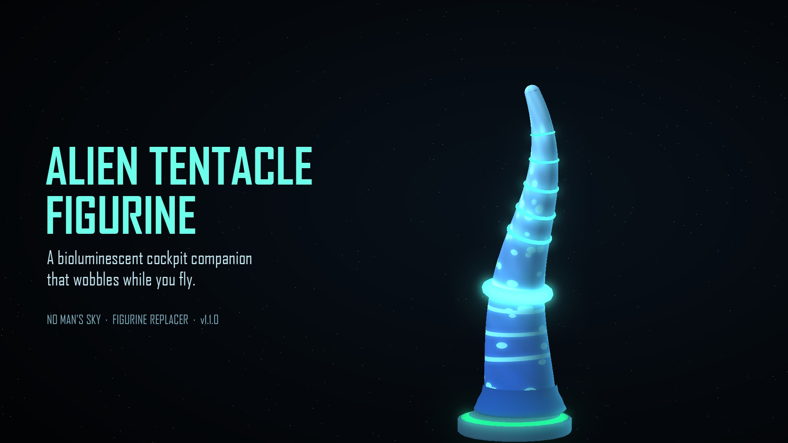

# Alien Tentacle – Figurine Replacer (No Man's Sky)



A cockpit figurine replacer for **No Man's Sky**. It swaps the **Atlas Figurine** (a cheap Quicksilver-shop item, so anyone can get it early)
for an original glowing alien tentacle on a suction-cup foot. The top half wobbles on the figurine's bobble joint
as your ship moves, five glowing rings run up its length, and the item is renamed **Alien Tentacle Figurine** in game.

- Visual only: it never touches your save
- Multiplayer safe: other players see the normal figurine
- Uninstall by deleting the mod folder

**Getting the Atlas Figurine:** buy it with Quicksilver from the Quicksilver Synthesis Companion on the Space Anomaly. Some reward starships also come with it installed.

**Players:** download the ready-made mod from Nexus Mods (or from this repo's Releases), then extract the
`AlienTentacleFigurine` folder into `No Man's Sky\GAMEDATA\MODS\`.

## Building it yourself

Nothing from the game is stored in this repo. The build reads the six game files it needs straight from
your own install, then generates everything else (model, materials, textures, text).

### Requirements
- Python 3.10+ with `pip install -r requirements.txt` (numpy, Pillow, hgpaktool)
- [MBINCompiler](https://github.com/monkeyman192/MBINCompiler/releases) matching your game version:
  put `MBINCompiler.exe` in `tools/bin/` or set the `MBINCOMPILER` environment variable

### Build
```
python tools/build.py --game "C:\Program Files (x86)\Steam\steamapps\common\No Man's Sky"
```
The finished mod is zipped into `dist/`. Add `--install` to copy it straight into your `GAMEDATA\MODS` folder.
Every build runs the release checks in `tools/check.py` (model data, scene links, bounding boxes, winding,
textures and mip chains, text files) and refuses to package if any fail.

To make the Nexus/README images afterwards: `python tools/render.py` (writes to `nexus/images/`).

### What's where
| Path | What it is |
|---|---|
| `tools/model.py` | Generates the tentacle geometry, materials and textures |
| `tools/build.py` | Extract → generate → assemble → check → zip |
| `tools/check.py` | Release checks |
| `tools/render.py` | Preview renders for the mod page |
| `tools/mod_readme.txt` | The readme that ships inside the mod |
| `nexus/` | Nexus Mods page text (BBCode) and images |

### How it works
The figurine's scene links its meshes by name, so the build keeps the original mesh names and replaces
their contents (the slot is set in `SLOT` in `tools/common.py`): the upper tentacle and its glowing rings hang off the figurine's head joint (that's what wobbles),
the foot and lower tentacle are static, and the original pedestal is kept (its glow ring recoloured green). A glowing collar sits over
the joint so no gap shows at any tilt.

One quirk worth knowing if you build NMS geometry with MBINCompiler: it writes each mesh's position-stream length
in the `.GEOMETRY.DATA.MBIN.PC` file as the vertex+index stream length (even for the game's own files). The game reads
streams by the offsets in the geometry header so it still renders, but `model.py` patches the lengths to match the
game's own format.

## Credits
- Built with [MBINCompiler](https://github.com/monkeyman192/MBINCompiler) and [HGPAKtool](https://github.com/monkeyman192/HGPAKtool)
- No Man's Sky is © Hello Games. This is an unofficial fan mod.

Author: MajorRoyMcCalluster
